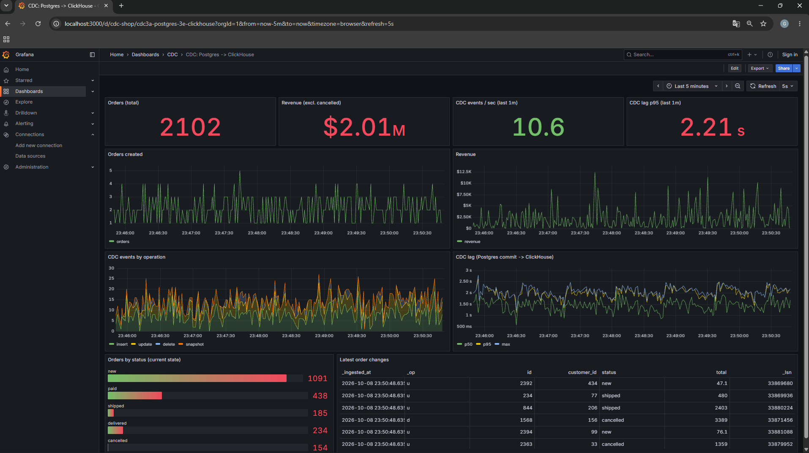
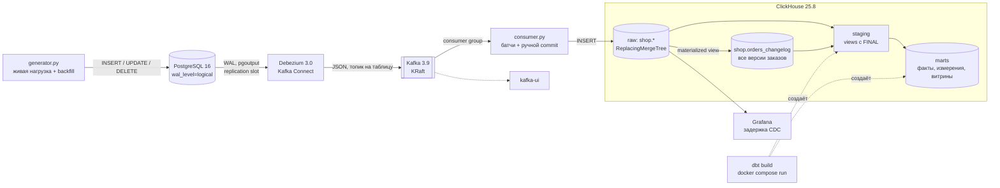
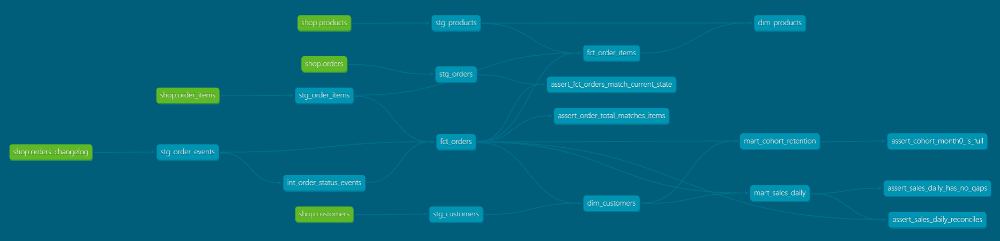

# Shop Data Platform

## In English

An end-to-end data platform for a simulated e-commerce shop, built entirely on open-source tools and runnable on a laptop with Docker Compose.

- **CDC ingestion**: PostgreSQL 16 → Debezium 3.0 (WAL, `pgoutput`) → Kafka 3.9 (KRaft) → Python consumer (batching, manual offset commits, retries) → ClickHouse 25.8 (`ReplacingMergeTree(_lsn, _is_deleted)`). End-to-end latency p50 ≈ 1.5 s; at-least-once delivery with an idempotent sink, verified by failure tests.
- **Full change history**: a ClickHouse materialized view keeps every CDC version of each order (status transitions, deletes), which the current-state tables lose after merges.
- **Warehouse in dbt** (`dbt-clickhouse`): raw → staging (views over `FINAL`) → marts (facts, dimensions, daily sales, monthly cohort retention) with 56 models and data tests, including reconciliation tests that caught real bugs.
- **Realistic history**: a reproducible 180-day backfill (~16k orders) generated from a decaying Poisson purchase process with Gamma-distributed customer intensity, so cohorts and RFM segments are meaningful.

Quick start: `cp .env.example .env`, `docker compose up -d --wait`, register the connector, run the consumer, `python generator.py --backfill-days 180`, then `docker compose run --rm dbt build`. Details below (in Russian).

Roadmap: Jupyter analytics with an A/B test, Superset BI, Airflow orchestration with CBR exchange rates, Prometheus metrics and DLQ, CI with pytest/ruff/dbt.

---

Платформа данных интернет-магазина: от OLTP-базы до витрин и аналитики. Изменения из PostgreSQL в реальном времени попадают в ClickHouse через CDC, поверх raw-слоя dbt строит staging и бизнес-витрины, Grafana показывает задержку пайплайна.

Проект вырос из [cdc-pg-clickhouse](https://github.com/Game-Fore/cdc-pg-clickhouse) и развивается по этапам:

| Этап | Что | Статус |
|---|---|---|
| 0 | CDC-пайплайн, сверка, замеры задержки, тесты отказов | ✅ |
| 1 | Хранилище в dbt: raw → staging → marts, тесты, документация | ✅ |
| 2 | Аналитика в Jupyter: GMV, воронка, когорты, RFM, A/B-тест | ⏳ |
| 3 | BI-дашборд в Superset | ⏳ |
| 4 | Оркестрация в Airflow, курсы ЦБ РФ, витрины в рублях | ⏳ |
| 5 | Надёжность: метрики consumer'а в Prometheus, алерты, DLQ | ⏳ |
| 6 | Качество: pytest, ruff, GitHub Actions | ⏳ |



## Архитектура



| Компонент | Роль | Порт |
|---|---|---|
| PostgreSQL 16 | Источник (OLTP), logical decoding через `pgoutput` | 5432 |
| Kafka 3.9 (KRaft) | Транспорт событий, без ZooKeeper | 29092 (с хоста) |
| Debezium 3.0 (Kafka Connect) | Снапшот + стриминг WAL в Kafka | 8083 |
| consumer.py | Kafka → ClickHouse, батчинг, at-least-once | — |
| ClickHouse 25.8 | Хранилище: raw, staging, marts | 8123, 9000 |
| dbt 1.11 + dbt-clickhouse | Трансформации и тесты данных (профиль `tools`) | 8081 (docs) |
| Grafana 12 | Технический дашборд CDC | 3000 |
| kafka-ui | Просмотр топиков и коннекторов | 8080 |

## Что демонстрирует проект

- **CDC на основе WAL**, а не polling по `updated_at`: ловятся все операции, включая `DELETE`, без нагрузки на таблицы-источники.
- **At-least-once с идемпотентным приёмником**: offset коммитится только после успешной вставки, повторы схлопываются в ClickHouse по LSN.
- **Историю изменений рядом с текущим состоянием**: materialized view сохраняет каждую версию заказа, поэтому воронка и время между статусами считаются честно, включая удалённые заказы.
- **Слоистое хранилище в dbt** с явными определениями метрик (GMV, выручка, средний чек, когорта) и тестами-сверками между слоями.
- **Особенности ClickHouse, которые ломают «обычный» SQL**: дефолты вместо NULL в `LEFT JOIN`, алиасы в `WHERE`, `LowCardinality` в выражениях, Nullable в ключе сортировки (см. [раздел про dbt](#хранилище-dbt)).
- **Измеримость**: end-to-end лаг, автоматическая сверка источника и приёмника, сценарии отказов.

## Структура проекта

```
.
├── docker-compose.yml          # весь стенд; dbt в профиле tools
├── .env.example                # шаблон паролей (сам .env не в git)
├── reset.ps1                   # полный сброс стенда + регистрация коннектора
├── connectors/
│   └── postgres-shop.json      # конфигурация Debezium-коннектора
├── postgres/init.sql           # схема магазина + стартовые товары
├── clickhouse/init.sql         # raw-таблицы + журнал orders_changelog (MV)
├── grafana/                    # datasource и дашборд CDC
├── generator.py                # живая OLTP-нагрузка; --backfill-days для истории
├── backfill.py                 # модель исторических данных
├── consumer/consumer.py        # Kafka → ClickHouse
├── verify.py                   # сверка Postgres и ClickHouse
├── dbt/
│   ├── Dockerfile, profiles.yml, dbt_project.yml, packages.yml
│   ├── macros/                 # schema name, бизнес-дата, условие выручки
│   ├── models/staging/         # sources + stg_* (views)
│   ├── models/intermediate/    # int_order_status_events (ephemeral)
│   ├── models/marts/           # fct_*, dim_*, mart_sales_daily, mart_cohort_retention
│   └── tests/                  # свой generic-тест и singular-сверки
└── docs/                       # скриншоты
```

## Быстрый старт

Требования: Docker Desktop (WSL2 с 10–12 ГБ памяти хватает с запасом), Python 3.11+.

```powershell
# 0. Пароли: скопировать шаблон и при желании поменять значения
Copy-Item .env.example .env

# 1. Поднять стенд и зарегистрировать коннектор
.\reset.ps1

# 2. Python-окружение
python -m venv .venv
.\.venv\Scripts\Activate.ps1
pip install -r requirements.txt

# 3. Окно 1: consumer
python .\consumer\consumer.py

# 4. Окно 2: история за 180 дней (~16k заказов, ~67k CDC-событий, ~1 мин), затем живая нагрузка
python generator.py --backfill-days 180
python generator.py --rps 5

# 5. Остановить генератор и сверить источник с приёмником
python verify.py

# 6. Хранилище: собрать модели и прогнать тесты
docker compose --profile tools build dbt
docker compose run --rm dbt deps
docker compose run --rm dbt build

# 7. Документация dbt и граф lineage: http://localhost:8081
docker compose run --rm dbt docs generate
docker compose run --rm --service-ports dbt docs serve --host 0.0.0.0 --port 8081
```

На Linux/macOS: `cp .env.example .env`, затем вместо `reset.ps1` выполните `docker compose up -d --wait` и зарегистрируйте коннектор:
`curl -X POST -H "Content-Type: application/json" --data @connectors/postgres-shop.json localhost:8083/connectors`.

Пауза и продолжение без потери данных: `docker compose stop` / `docker compose start`. Команда `docker compose down` удаляет контейнеры вместе с данными (у сервисов нет volume), после неё нужен `reset.ps1`.

| UI | Адрес |
|---|---|
| Grafana | http://localhost:3000 (дашборд **CDC → CDC: Postgres -> ClickHouse**) |
| kafka-ui | http://localhost:8080 |
| Debezium REST | http://localhost:8083/connectors/shop-connector/status |
| dbt docs | http://localhost:8081 (после `dbt docs serve`) |

## Как это устроено

### Источник: PostgreSQL

Схема магазина: `customers`, `products`, `orders`, `order_items`. Для CDC включено:

- `wal_level=logical`, `max_replication_slots`, `max_wal_senders`: без них logical decoding недоступен;
- `REPLICA IDENTITY FULL` на всех таблицах: в событиях UPDATE/DELETE приходит полная старая версия строки, а не только первичный ключ.

**Живая нагрузка** (`generator.py`): взвешенные случайные действия, каждое в своей транзакции: создание заказа с позициями, переходы статусов `new → paid → shipped → delivered | cancelled`, изменение цен, переезд клиентов и удаление отменённых заказов (с каскадным удалением позиций). Так в потоке присутствуют все три типа операций.

**История** (`generator.py --backfill-days 180`, логика в `backfill.py`): вся история сначала строится в памяти как список событий с бизнес-временем, затем сортируется и пишется в Postgres обычными `INSERT`/`UPDATE`. Поэтому backfill проходит через тот же CDC-пайплайн, а LSN растёт вместе со временем событий.

| Что моделируется | Как |
|---|---|
| Приток клиентов | пуассоновский поток, линейный рост ×0.7 → ×1.3, недельная сезонность |
| Повторные покупки | неоднородный пуассоновский процесс с интенсивностью `λᵢ·exp(−t/60 дней)`: активность клиента затухает, отсюда реалистичный retention |
| Различия между клиентами | `λᵢ ~ Gamma(0.6, ·)`: много разовых покупателей и длинный хвост лояльных (основа для RFM) |
| Жизненный цикл заказа | оплата через ~2 ч, отгрузка через 0.5–3 дня, доставка через 2–6 дней, 12% отмен до оплаты и 4% после |
| Цены | случайное блуждание ±10% примерно раз в две недели; в позиции заказа фиксируется цена на момент покупки |

`--seed 42` по умолчанию делает набор данных воспроизводимым. Бизнес-время лежит в `created_at`/`updated_at`; `_source_ts` и `_ingested_at` для backfill-данных показывают время загрузки, а не событий.

### Захват изменений: Debezium

Ключевые параметры коннектора (`connectors/postgres-shop.json`):

| Параметр | Значение | Зачем |
|---|---|---|
| `plugin.name` | `pgoutput` | встроенный плагин logical decoding, ничего не нужно ставить |
| `snapshot.mode` | `initial` | при первом запуске выгрузить текущее содержимое таблиц |
| `decimal.handling.mode` | `string` | `NUMERIC` без потери точности (по умолчанию приходит base64) |
| `value.converter.schemas.enable` | `false` | не тащить схему в каждое сообщение |
| `transforms.unwrap` | `ExtractNewRecordState` | плоская строка вместо конверта `before/after` |
| `add.fields` | `op,lsn,source.ts_ms` | тип операции, версия и время коммита в каждом сообщении |
| `delete.tombstone.handling.mode` | `rewrite` | DELETE приходит обычной записью с `__deleted = "true"` |
| `database.password` | `${env:POSTGRES_PASSWORD}` | пароль подставляет воркер через `EnvVarConfigProvider`, в JSON и REST API его нет |

Пример события в топике `shop.public.orders`:

```json
{
  "id": 106, "customer_id": 73, "status": "paid", "total": "1529.97",
  "created_at": "2026-10-05T08:33:39.947123Z", "updated_at": "2026-10-05T08:33:52.011540Z",
  "__deleted": "false", "__op": "u", "__lsn": 27463816, "__source_ts_ms": 1791189232011
}
```

### Доставка: consumer

`consumer/consumer.py` читает четыре топика одной consumer group и пишет в ClickHouse:

- **Батчинг**: буферы сбрасываются по размеру (1000 строк) или по таймеру (1 с), что наступит раньше.
- **Ручной commit**: `enable.auto.commit=false`, offset коммитится только после успешной вставки всех буферов.
- **Ретраи**: при ошибке вставки 5 попыток с экспоненциальным backoff (2, 4, 8, 16, 32 с), затем падение без коммита. Лучше упасть громко, чем молча потерять данные.
- **Поздно созданные топики**: Debezium создаёт топик при первом событии таблицы. `topic.metadata.refresh.interval.ms=5000` позволяет consumer'у, запущенному раньше, подхватить их за секунды, а не за 5 минут по умолчанию; пустой commit после ребаланса (`_NO_OFFSET`) не считается ошибкой.
- **Graceful shutdown**: по Ctrl+C дописывается хвост буфера, коммитятся offset'ы, consumer корректно выходит из группы.

### Raw-слой: ClickHouse

Каждая таблица — `ReplacingMergeTree(_lsn, _is_deleted) ORDER BY id` со служебными колонками:

| Колонка | Источник | Назначение |
|---|---|---|
| `_op` | `__op` | `c` / `u` / `d` / `r` (снапшот) |
| `_lsn` | `__lsn` | версия строки: LSN монотонно растёт, даже внутри одной транзакции |
| `_source_ts` | `__source_ts_ms` | время коммита в Postgres |
| `_is_deleted` | `__deleted` | удалённые строки отбрасываются при `FINAL` |
| `_ingested_at` | `DEFAULT now64(3)` | время вставки в ClickHouse |

Текущее состояние читается через `FINAL`. Повторно доставленные сообщения имеют тот же `_lsn`, поэтому схлопываются: так получается идемпотентность без exactly-once.

**Журнал заказов.** После мержа `ReplacingMergeTree` хранит только последнюю версию строки, а для воронки нужны все переходы статусов. Поэтому рядом лежит `shop.orders_changelog`, который заполняет materialized view. В ClickHouse MV — это триггер на `INSERT`: каждый блок, который consumer вставляет в `shop.orders`, тем же запросом пишется в журнал, consumer менять не нужно. Ключ `(order_id, _lsn)` уникален для события, поэтому повторная доставка тоже схлопывается.

| order_id | status | total | _op | _is_deleted |
|---|---|---|---|---|
| 114 | new | 0 | c | 0 |
| 114 | new | 2569.53 | u | 0 |
| 114 | cancelled | 2569.53 | u | 0 |
| 114 | cancelled | 2569.53 | d | 1 |

Почему не dbt snapshots: снапшот видит состояние только в момент запуска и пропускает переходы между запусками, а журнал из CDC — нет.

### Хранилище: dbt



dbt запускается в контейнере (`docker compose run --rm dbt ...`), одинаково на Windows, Linux и в CI. Проект смонтирован как volume, пересобирать образ после правки моделей не нужно. Пароли берутся из `.env` через `env_var()`.

| Слой | База ClickHouse | Материализация | Содержимое |
|---|---|---|---|
| raw | `shop` | source (таблицами владеет CDC) | таблицы consumer'а и журнал; проверка свежести по `_ingested_at` |
| staging | `staging` | view | `FROM ... FINAL WHERE _is_deleted = 0`, переименование, бизнес-дата |
| intermediate | — | ephemeral (CTE) | `int_order_status_events`: только смены статуса из журнала |
| marts | `marts` | table, `ORDER BY` под фильтр по дате | `fct_orders`, `fct_order_items`, `dim_customers`, `dim_products`, `mart_sales_daily`, `mart_cohort_retention` |

**Почему marts — таблицы с полной пересборкой, а не incremental.** Метрики последних дней «дозревают»: вчерашний заказ сегодня оплачивается или отменяется (в данных это видно: доля отмен у свежих дней ~6%, у старых ~16%). Инкрементальной модели пришлось бы пересчитывать окно в несколько дней и отдельно обрабатывать удаления. На ~16k заказов полная пересборка всего проекта занимает около 1.5 с.

**Почему `fct_orders` собирается из журнала, а не из текущего состояния.** Удалённые отменённые заказы остались только в журнале. Без них отмены в воронке и `cancel_rate` были бы занижены. Совпадение двух путей для не удалённых заказов проверяет отдельный тест.

**Определения метрик** (заданы в одном месте через `vars` и макросы):

| Метрика | Определение |
|---|---|
| Бизнес-дата | дата создания заказа в `Europe/Moscow` (`var business_tz`) |
| GMV | сумма всех оформленных заказов, включая отменённые |
| Выручка | сумма заказов со статусом `paid`, `shipped`, `delivered` (`var revenue_statuses`) |
| Средний чек | выручка / число оплаченных заказов; NULL, если оплаченных нет |
| Когорта | месяц первой *покупки* (не регистрации и не первого заказа) |
| Retention месяца N | доля когорты с покупкой в месяце N; ещё не наступившие месяцы отсутствуют, а не равны 0 |

**Тесты** (56 узлов в `dbt build`): `unique`, `not_null`, `relationships`, `accepted_values`; из `dbt_utils` — `expression_is_true` (статусы идут по порядку), `accepted_range`, `unique_combination_of_columns`; свой generic-тест `non_negative`; singular-сверки:

| Тест | Что проверяет |
|---|---|
| `assert_order_total_matches_items` | сумма заказа = сумма позиций (кроме заказов моложе 5 минут) |
| `assert_fct_orders_match_current_state` | журнал CDC и `FINAL` дают одинаковое состояние заказов |
| `assert_sales_daily_reconciles` | витрина по дням сходится с фактом по заказам и выручке |
| `assert_sales_daily_has_no_gaps` | в витрине нет пропущенных дат |
| `assert_cohort_month0_is_full` | в месяц когорты активны все её клиенты |

**Особенности ClickHouse, найденные по ходу:**

| Ловушка | Что происходит | Решение |
|---|---|---|
| `LEFT JOIN` без совпадения | вместо NULL подставляются дефолты: `0`, `''`, `1970-01-01` | `join_use_nulls = 1` в `profiles.yml`, агрегаты `*OrNull` |
| Алиас = имя колонки | алиас из `SELECT` виден в `WHERE`: `where cohort_month is not null` проверял `assumeNotNull(cohort_month)`, и 1043 клиента без покупок попали в «когорту 1970-01-01». Поймал тест `assert_cohort_month0_is_full` | фильтр во внутреннем подзапросе |
| `status in (...)` на `LowCardinality(String)` | результат `LowCardinality(UInt8)`, такие колонки создавать запрещено | `cast(... as Bool)` |
| Nullable в `ORDER BY` таблицы | после `join_use_nulls` колонки из правой части JOIN становятся Nullable, а Nullable-ключ запрещён | ключ из колонок левой таблицы или `assumeNotNull` после фильтра |

## Результаты

### Консистентность

`verify.py` сравнивает Postgres и ClickHouse `FINAL` по каждой таблице, а также последнюю версию каждого заказа в журнале. Скрипт отказывается работать, пока источник меняется, ждёт, пока consumer догонит, и отдельно показывает ещё не схлопнутые дубли. После backfill за 180 дней:

```
check              status postgres | clickhouse
customers          OK     6773, 22940151, 3515
products           OK     8, 1481.88
orders             OK     16332, 133375278, 16112807.01
orders_by_status   OK     cancelled=2547,delivered=13062,new=23,paid=220,shipped=480
orders_changelog   OK     16332, 133375278, 16112807.01
order_items        OK     40828, 833483206, 81497, 16112807.01

RESULT: CONSISTENT
```

66.7k событий backfill записываются в Postgres за ~53 с, ClickHouse полностью догоняет источник примерно через минуту после старта.

### Задержка (end-to-end)

Лаг считается как `_ingested_at - _source_ts`, то есть от коммита транзакции в Postgres до записи строки в ClickHouse. Нагрузка 5 действий/с, локальный стенд на Docker Desktop:

| p50 | p95 | p99 |
|---|---|---|
| 1.5 с | 2.3 с | 2.4 с |

| Этап | Вклад |
|---|---|
| Debezium (`poll.interval.ms`, по умолчанию 500 мс) | до ~0.5 с |
| Буфер consumer'а (`FLUSH_INTERVAL_SEC = 1.0`) | до 1 с |
| Kafka, сеть, вставка в ClickHouse | десятки–сотни мс |

Лаг можно уменьшить до ~0.3–0.5 с (`poll.interval.ms=100`, `FLUSH_INTERVAL_SEC=0.2`) ценой в 5 раз более частых мелких вставок в ClickHouse. Это классический компромисс между латентностью и размером батча; для аналитики секундная задержка обычно приемлема.

### Отказоустойчивость

Каждый сценарий выполнялся под нагрузкой, после чего генератор останавливался и запускался `verify.py`. Чтобы дубли можно было увидеть до фонового мержа, на время теста мержи останавливались (`verify.py --stop-merges` / `--start-merges`).

| Сценарий | Как ломали | Результат | Дубли | Что показывает |
|---|---|---|---|---|
| Consumer упал между вставкой и commit | `consumer.py --crash-after-flush N` | CONSISTENT | 15 строк (1 батч) | at-least-once: батч доставлен повторно и схлопнут по `_lsn` |
| ClickHouse недоступен ~15 с | `docker stop clickhouse` | CONSISTENT | — | ретраи с backoff; пока вставка не прошла, offset не коммитится |
| Debezium убит | `docker kill connect` | CONSISTENT | — | replication slot держал WAL (`active = f`, 416 kB), после рестарта чтение продолжилось с сохранённого LSN |
| Consumer запущен раньше, чем появились топики | `reset.ps1`, consumer, затем генератор | CONSISTENT | — | новые топики подхватываются за ~5 с, consumer переживает ребаланс |

### Витрины (backfill 180 дней, seed 42)

Воронка заказов (`marts.fct_orders`, включая удалённые в источнике):

| Создано | Оплачено | Отгружено | Доставлено | Отменено | Медиана до оплаты |
|---|---|---|---|---|---|
| 16 332 | 14 343 (87.8%) | 13 542 | 13 062 (80.0%) | 2 547 | 2.1 ч |

Месячный retention по когортам первой покупки (`marts.mart_cohort_retention`; пустые ячейки — месяцы, которые когорта ещё не прожила):

| Когорта | Размер | M0 | M1 | M2 | M3 | M4 | M5 |
|---|---|---|---|---|---|---|---|
| 2026-05 | 710 | 100% | 36.6% | 29.4% | 15.9% | 13.5% | 7.0% |
| 2026-06 | 807 | 100% | 37.5% | 26.9% | 16.9% | 11.2% | |
| 2026-07 | 978 | 100% | 39.2% | 25.5% | 19.7% | | |
| 2026-08 | 1061 | 100% | 37.2% | 24.8% | | | |
| 2026-09 | 1089 | 100% | 37.0% | | | | |
| 2026-10 | 1076 | 100% | | | | | |

Последний столбец каждой когорты относится к текущему, ещё не закончившемуся месяцу (`is_complete_period = false`). Апрельская когорта (9 человек) не показана: данные начинаются 30 апреля.

## Ограничения и что учесть в продакшене

- **Replication slot удерживает WAL**, пока коннектор не подтвердит чтение. Если Debezium долго лежит, WAL растёт и может заполнить диск Postgres. Нужен алерт на `pg_replication_slots` и/или `max_slot_wal_keep_size`.
- **Повторы есть на двух уровнях**: Debezium после жёсткого падения переотправляет события с последнего сброса offset'ов (раз в 60 с), consumer — последний незакоммиченный батч. Корректность держится на идемпотентности приёмника, поэтому запросы к текущему состоянию должны использовать `FINAL` (или `argMax` по `_lsn`).
- **Ребаланс не обрабатывается явно**: строки, прочитанные до отзыва партиций, вставляются, но их offset'ы могут не закоммититься и будут прочитаны повторно. Безопасно благодаря идемпотентности; правильное решение — flush и commit в `on_revoke` (этап 5).
- **dbt на живом потоке**: `orders` и `order_items` приходят разными `INSERT`, поэтому тест `relationships` для позиций может кратко упасть, если запустить `dbt build` во время генерации. Сейчас dbt запускается при остановленном генераторе; окно допуска появится вместе с расписанием в Airflow.
- **Эволюция схемы** не автоматизирована: новую колонку в Postgres нужно вручную добавить в ClickHouse и в маппинг consumer'а.
- **Одна партиция на топик**: порядок событий по ключу гарантирован, но масштабирование consumer'а ограничено.
- **Нет DLQ**: битые сообщения логируются и пропускаются (этап 5).
- **Локальный стенд**: один брокер, replication factor 1, анонимный admin-доступ в Grafana, у сервисов нет volume. dbt пишет в ClickHouse тем же пользователем, что и consumer; в продакшене нужны отдельные пользователи с правами только на свои базы.

## Дальше

- Jupyter: GMV, воронка, когорты, RFM-сегментация, симуляция A/B-теста со статистическим разбором.
- Superset: бизнес-дашборд поверх `marts`, отдельно от технической Grafana.
- Airflow: ежедневный `dbt build`, проверки качества, курсы валют ЦБ РФ и витрины в рублях.
- Prometheus: метрики consumer'а (лаг, размер батча, ошибки), алерты, DLQ-топик.
- CI: pytest для consumer'а и генератора, ruff, `dbt build` на стенде в GitHub Actions.
