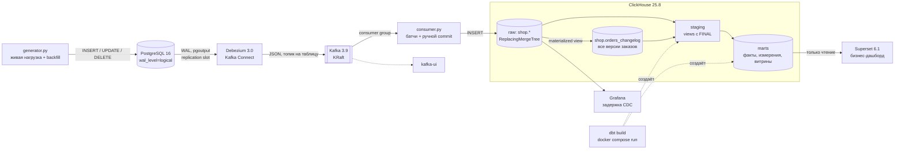
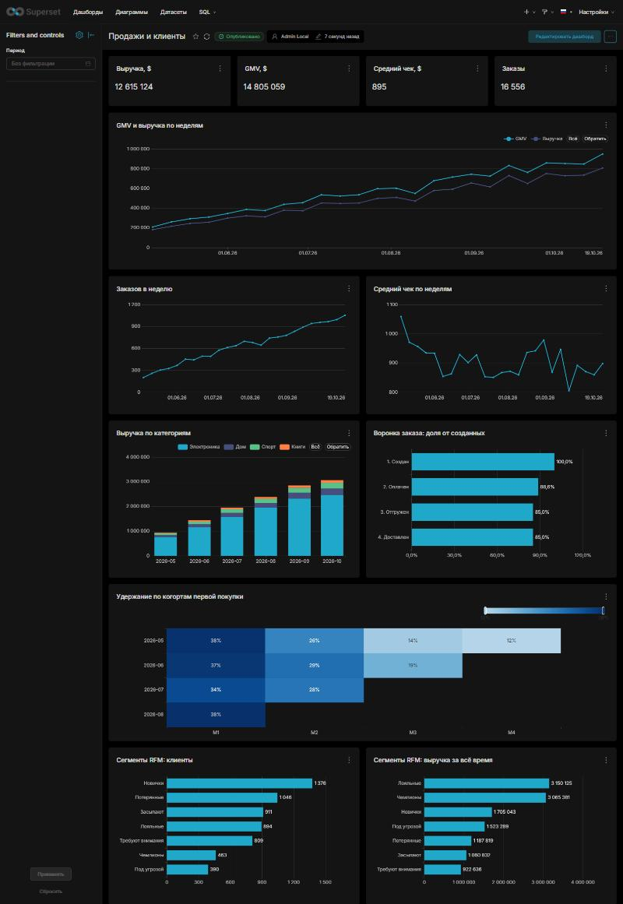
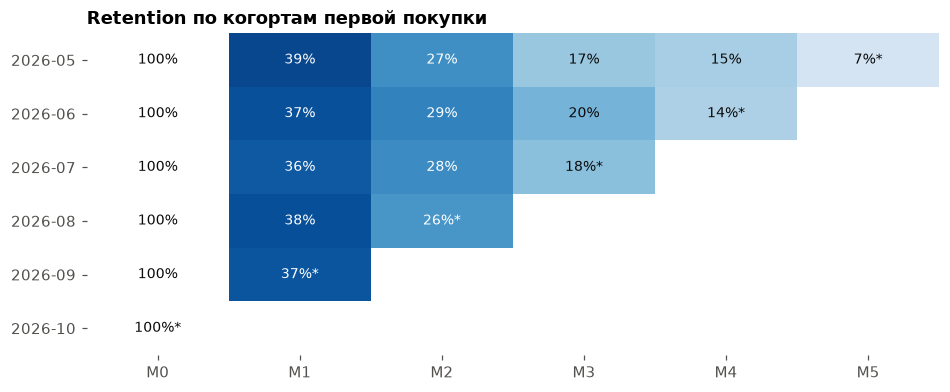
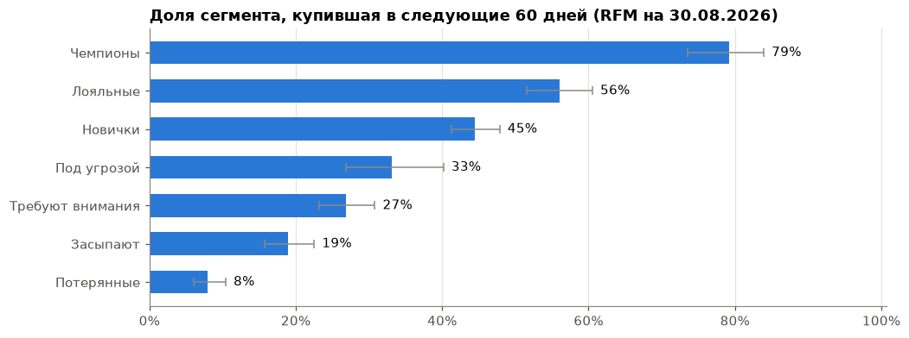
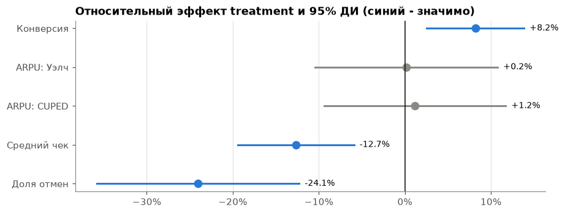

# Платформа данных интернет-магазина

Платформа данных интернет-магазина: от OLTP-базы до витрин и аналитики. Изменения из PostgreSQL в реальном времени попадают в ClickHouse через CDC, поверх raw-слоя dbt строит staging и бизнес-витрины, Grafana показывает задержку пайплайна. Всё на open-source инструментах и запускается на ноутбуке через Docker Compose.

Коротко:

- **CDC**: PostgreSQL 16 → Debezium 3.0 (WAL, `pgoutput`) → Kafka 3.9 (KRaft) → Python-consumer (батчи, ручной commit offset'ов, ретраи) → ClickHouse 25.8 (`ReplacingMergeTree(_lsn, _is_deleted)`). Задержка p50 ≈ 1.5 с, доставка at-least-once с идемпотентным приёмником, проверена тестами отказов.
- **Полная история изменений**: materialized view в ClickHouse сохраняет каждую версию заказа (переходы статусов, удаления), которую таблицы текущего состояния теряют после мержа.
- **Хранилище в dbt** (`dbt-clickhouse`): raw → staging (views с `FINAL`) → marts (факты, измерения, продажи по дням, когортный retention, RFM, A/B), 86 моделей и тестов в `dbt build`, включая сверки между слоями, которые нашли реальные ошибки.
- **Реалистичная история**: воспроизводимый backfill за 180 дней (~16 тыс. заказов) на основе затухающего пуассоновского процесса покупок с Gamma-распределённой активностью клиентов, поэтому когорты и RFM-сегменты осмысленны.
- **Аналитика в Jupyter**: продажи, воронка с учётом цензурирования, когорты и LTV, RFM с бэктестом, A/B-тест скидки: дизайн, MDE, SRM, A/A, z-тест, Уэлч, бутстреп, CUPED, delta-метод и решение с учётом прибыли.
- **BI как код**: дашборд в Superset хранится в git как YAML и поднимается автоматически; доступ к ClickHouse только на чтение витрин.

Проект вырос из [cdc-pg-clickhouse](https://github.com/Game-Fore/cdc-pg-clickhouse) и развивается по этапам:

| Этап | Что | Статус |
|---|---|---|
| 0 | CDC-пайплайн, сверка, замеры задержки, тесты отказов | ✅ |
| 1 | Хранилище в dbt: raw → staging → marts, тесты, документация | ✅ |
| 2 | Аналитика в Jupyter: GMV, воронка, когорты, RFM, A/B-тест | ✅ |
| 3 | BI-дашборд в Superset | ✅ |
| 4 | Оркестрация в Airflow, курсы ЦБ РФ, витрины в рублях | ⏳ |
| 5 | Надёжность: метрики consumer'а в Prometheus, алерты, DLQ | ⏳ |
| 6 | Качество: pytest, ruff, GitHub Actions | ⏳ |


## Архитектура



| Компонент | Роль | Порт |
|---|---|---|
| PostgreSQL 16 | Источник (OLTP), logical decoding через `pgoutput` | 5432 |
| Kafka 3.9 (KRaft) | Транспорт событий, без ZooKeeper | 29092 (с хоста) |
| Debezium 3.0 (Kafka Connect) | Снапшот + стриминг WAL в Kafka | 8083 |
| consumer.py | Kafka → ClickHouse, батчинг, at-least-once | — |
| ClickHouse 25.8 | Хранилище: raw, staging, marts | 8123, 9000 |
| dbt 1.11 + dbt-clickhouse | Трансформации и тесты данных (профиль `tools`) | 8081 (docs) |
| Superset 6.1 | Бизнес-дашборд поверх витрин (профиль `bi`) | 8088 |
| Grafana 12 | Технический дашборд CDC | 3000 |
| kafka-ui | Просмотр топиков и коннекторов | 8080 |

## Что демонстрирует проект

- **CDC на основе WAL**, а не polling по `updated_at`: ловятся все операции, включая `DELETE`, без нагрузки на таблицы-источники.
- **At-least-once с идемпотентным приёмником**: offset коммитится только после успешной вставки, повторы схлопываются в ClickHouse по LSN.
- **Историю изменений рядом с текущим состоянием**: materialized view сохраняет каждую версию заказа, поэтому воронка и время между статусами считаются честно, включая удалённые заказы.
- **Слоистое хранилище в dbt** с явными определениями метрик (GMV, выручка, средний чек, когорта) и тестами-сверками между слоями.
- **Особенности ClickHouse, которые ломают «обычный» SQL**: дефолты вместо NULL в `LEFT JOIN`, алиасы в `WHERE`, `LowCardinality` в выражениях, Nullable в ключе сортировки (см. [раздел про dbt](#хранилище-dbt)).
- **Измеримость**: end-to-end лаг, автоматическая сверка источника и приёмника, сценарии отказов.
- **Аналитику с проверкой методов**: цензурирование в воронке и времени до второй покупки, бэктест сегментов, A/A-симуляция тестов, сверка оценок A/B-теста с заложенными в генератор эффектами.

## Структура проекта

```
.
├── docker-compose.yml          # весь стенд; dbt в профиле tools
├── .env.example                # шаблон паролей (сам .env не в git)
├── reset.ps1                   # полный сброс стенда + регистрация коннектора
├── connectors/
│   └── postgres-shop.json      # конфигурация Debezium-коннектора
├── postgres/init.sql           # схема магазина + стартовые товары
├── clickhouse/init.sql         # raw-таблицы + журнал orders_changelog (MV)
├── grafana/                    # datasource и дашборд CDC
├── generator.py                # живая OLTP-нагрузка; --backfill-days для истории
├── backfill.py                 # модель исторических данных
├── consumer/consumer.py        # Kafka → ClickHouse
├── verify.py                   # сверка Postgres и ClickHouse
├── requirements-analytics.txt  # зависимости ноутбуков (отдельно от пайплайна)
├── analytics/                  # общий код: db.py, stats.py, rfm.py, plots.py
├── notebooks/                  # 01 продажи, 02 воронка, 03 когорты, 04 RFM, 05 A/B-тест
├── superset/                   # образ, настройки, запуск; dashboards/ - дашборд как YAML
├── dbt/
│   ├── Dockerfile, profiles.yml, dbt_project.yml, packages.yml
│   ├── macros/                 # schema name, дата среза, условие выручки
│   ├── models/staging/         # sources + stg_* (views)
│   ├── models/intermediate/    # int_order_status_events (ephemeral)
│   ├── models/marts/           # fct_*, dim_*, продажи, когорты, RFM, A/B
│   ├── seeds/                  # реестр экспериментов
│   └── tests/                  # свой generic-тест и singular-сверки
└── docs/                       # скриншоты
```

## Быстрый старт

Требования: Docker Desktop (WSL2 с 10–12 ГБ памяти хватает с запасом), Python 3.11+.

```powershell
# 0. Пароли: скопировать шаблон и при желании поменять значения
Copy-Item .env.example .env

# 1. Поднять стенд и зарегистрировать коннектор
.\reset.ps1

# 2. Python-окружение
python -m venv .venv
.\.venv\Scripts\Activate.ps1
pip install -r requirements.txt

# 3. Окно 1: consumer
python .\consumer\consumer.py

# 4. Окно 2: история за 180 дней (~16.4k заказов, ~115k CDC-событий, ~1 мин)
python generator.py --backfill-days 180
# при желании живая нагрузка (числа в README и ноутбуках посчитаны без неё)
python generator.py --rps 5

# 5. Остановить генератор и сверить источник с приёмником
python verify.py

# 6. Хранилище: собрать модели и прогнать тесты
docker compose --profile tools build dbt
docker compose run --rm dbt deps
docker compose run --rm dbt build

# 7. Документация dbt и граф lineage: http://localhost:8081
docker compose run --rm dbt docs generate
docker compose run --rm --service-ports dbt docs serve --host 0.0.0.0 --port 8081

# 8. Ноутбуки (venv должен быть активирован: ядро запускает python из PATH)
pip install -r requirements-analytics.txt
jupyter lab notebooks

# 9. BI: http://localhost:8088, логин admin, пароль SUPERSET_ADMIN_PASSWORD из .env
docker compose --profile bi up -d --wait superset
```

Весь путь от `reset.ps1` до готового дашборда на чистом стенде занимает около 2.5 минут. Superset поднимайте после `dbt build`: чарты читают витрины.

На Linux/macOS: `cp .env.example .env`, затем вместо `reset.ps1` выполните `docker compose up -d --wait` и зарегистрируйте коннектор:
`curl -X POST -H "Content-Type: application/json" --data @connectors/postgres-shop.json localhost:8083/connectors`.

Пауза и продолжение без потери данных: `docker compose --profile bi stop` / `docker compose --profile bi start`. Команда `docker compose down` удаляет контейнеры вместе с данными (у сервисов нет volume), после неё нужен `reset.ps1`.

| UI | Адрес |
|---|---|
| Grafana | http://localhost:3000 (дашборд **CDC → CDC: Postgres -> ClickHouse**) |
| kafka-ui | http://localhost:8080 |
| Debezium REST | http://localhost:8083/connectors/shop-connector/status |
| dbt docs | http://localhost:8081 (после `dbt docs serve`) |
| Superset | http://localhost:8088/superset/dashboard/sales-and-customers/ |

## Как это устроено

### Источник: PostgreSQL

Схема магазина: `customers`, `products`, `orders`, `order_items`. Для CDC включено:

- `wal_level=logical`, `max_replication_slots`, `max_wal_senders`: без них logical decoding недоступен;
- `REPLICA IDENTITY FULL` на всех таблицах: в событиях UPDATE/DELETE приходит полная старая версия строки, а не только первичный ключ.

**Живая нагрузка** (`generator.py`): взвешенные случайные действия, каждое в своей транзакции: создание заказа с позициями, переходы статусов `new → paid → shipped → delivered | cancelled`, изменение цен, переезд клиентов и удаление отменённых заказов (с каскадным удалением позиций). Так в потоке присутствуют все три типа операций.

**История** (`generator.py --backfill-days 180`, логика в `backfill.py`): вся история сначала строится в памяти как список событий с бизнес-временем, затем сортируется и пишется в Postgres обычными `INSERT`/`UPDATE`. Поэтому backfill проходит через тот же CDC-пайплайн, а LSN растёт вместе со временем событий.

| Что моделируется | Как |
|---|---|
| Приток клиентов | пуассоновский поток, линейный рост ×0.7 → ×1.3, недельная сезонность |
| Повторные покупки | неоднородный пуассоновский процесс с интенсивностью `λᵢ·exp(−t/60 дней)`: активность клиента затухает, отсюда реалистичный retention |
| Различия между клиентами | `λᵢ ~ Gamma(0.6, ·)`: много разовых покупателей и длинный хвост лояльных (основа для RFM) |
| Жизненный цикл заказа | оплата через ~2 ч, отгрузка через 0.5–3 дня, доставка через 2–6 дней, 12% отмен до оплаты и 4% после |
| Цены | случайное блуждание ±10% примерно раз в две недели; в позиции заказа фиксируется цена на момент покупки |

История отсчитывается не от момента запуска, а от фиксированного конца `--end-at` (ISO-дата, без таймзоны считается UTC; по умолчанию `2026-10-29T12:00:00Z`). От него же считаются начало истории и окно эксперимента. Поэтому один `--seed` и один `--end-at` дают одни и те же данные при любом запуске: две сборки стенда с нуля совпали построчно по `customers`, `products`, `orders`, `order_items` и `experiment_assignments`. Числа в ноутбуках и README получены на значениях по умолчанию и воспроизводятся (имена, email и города зависят ещё от версии Faker, суммы и заказы — нет). Другой конец истории — это другая выборка из той же модели. Два прежних набора дали выручку 12.6 и 14.3 млн, этот 16.7 млн: заказов и проданных штук почти столько же, разницу создаёт случайное блуждание цен дорогой электроники. Рост конверсии в тесте при этом был 2.6, 3.2 и 3.4 п.п., а выводы не менялись. Бизнес-время лежит в `created_at`/`updated_at`; `_source_ts` и `_ingested_at` для backfill-данных показывают время загрузки, а не событий.

**A/B-эксперимент** (`discount_10`, последние 42 дня истории). Группа назначается детерминированным хэшем `md5(id эксперимента:клиент)`, 50/50, назначение записывается в таблицу `experiment_assignments` и едет через CDC. Для группы treatment в окне эксперимента заложены истинные эффекты: цена ×0.90, доля неоплаченных заказов 8% вместо 12%, повторные покупки ×1.15. Ноутбук `05_ab_test` восстанавливает их по данным.

### Захват изменений: Debezium

Ключевые параметры коннектора (`connectors/postgres-shop.json`):

| Параметр | Значение | Зачем |
|---|---|---|
| `plugin.name` | `pgoutput` | встроенный плагин logical decoding, ничего не нужно ставить |
| `snapshot.mode` | `initial` | при первом запуске выгрузить текущее содержимое таблиц |
| `decimal.handling.mode` | `string` | `NUMERIC` без потери точности (по умолчанию приходит base64) |
| `value.converter.schemas.enable` | `false` | не тащить схему в каждое сообщение |
| `transforms.unwrap` | `ExtractNewRecordState` | плоская строка вместо конверта `before/after` |
| `add.fields` | `op,lsn,source.ts_ms` | тип операции, версия и время коммита в каждом сообщении |
| `delete.tombstone.handling.mode` | `rewrite` | DELETE приходит обычной записью с `__deleted = "true"` |
| `database.password` | `${env:POSTGRES_PASSWORD}` | пароль подставляет воркер через `EnvVarConfigProvider`, в JSON и REST API его нет |

Пример события в топике `shop.public.orders`:

```json
{
  "id": 106, "customer_id": 73, "status": "paid", "total": "1529.97",
  "created_at": "2026-10-05T08:33:39.947123Z", "updated_at": "2026-10-05T08:33:52.011540Z",
  "__deleted": "false", "__op": "u", "__lsn": 27463816, "__source_ts_ms": 1791189232011
}
```

### Доставка: consumer

`consumer/consumer.py` читает четыре топика одной consumer group и пишет в ClickHouse:

- **Батчинг**: буферы сбрасываются по размеру (1000 строк) или по таймеру (1 с), что наступит раньше.
- **Ручной commit**: `enable.auto.commit=false`, offset коммитится только после успешной вставки всех буферов.
- **Ретраи**: при ошибке вставки 5 попыток с экспоненциальным backoff (2, 4, 8, 16, 32 с), затем падение без коммита. Лучше упасть громко, чем молча потерять данные.
- **Поздно созданные топики**: Debezium создаёт топик при первом событии таблицы. `topic.metadata.refresh.interval.ms=5000` позволяет consumer'у, запущенному раньше, подхватить их за секунды, а не за 5 минут по умолчанию; пустой commit после ребаланса (`_NO_OFFSET`) не считается ошибкой.
- **Graceful shutdown**: по Ctrl+C дописывается хвост буфера, коммитятся offset'ы, consumer корректно выходит из группы.

### Raw-слой: ClickHouse

Каждая таблица — `ReplacingMergeTree(_lsn, _is_deleted) ORDER BY id` со служебными колонками:

| Колонка | Источник | Назначение |
|---|---|---|
| `_op` | `__op` | `c` / `u` / `d` / `r` (снапшот) |
| `_lsn` | `__lsn` | версия строки: LSN монотонно растёт, даже внутри одной транзакции |
| `_source_ts` | `__source_ts_ms` | время коммита в Postgres |
| `_is_deleted` | `__deleted` | удалённые строки отбрасываются при `FINAL` |
| `_ingested_at` | `DEFAULT now64(3)` | время вставки в ClickHouse |

Текущее состояние читается через `FINAL`. Повторно доставленные сообщения имеют тот же `_lsn`, поэтому схлопываются: так получается идемпотентность без exactly-once.

**Журнал заказов.** После мержа `ReplacingMergeTree` хранит только последнюю версию строки, а для воронки нужны все переходы статусов. Поэтому рядом лежит `shop.orders_changelog`, который заполняет materialized view. В ClickHouse MV — это триггер на `INSERT`: каждый блок, который consumer вставляет в `shop.orders`, тем же запросом пишется в журнал, consumer менять не нужно. Ключ `(order_id, _lsn)` уникален для события, поэтому повторная доставка тоже схлопывается.

| order_id | status | total | _op | _is_deleted |
|---|---|---|---|---|
| 114 | new | 0 | c | 0 |
| 114 | new | 2569.53 | u | 0 |
| 114 | cancelled | 2569.53 | u | 0 |
| 114 | cancelled | 2569.53 | d | 1 |

Почему не dbt snapshots: снапшот видит состояние только в момент запуска и пропускает переходы между запусками, а журнал из CDC — нет.

### Хранилище: dbt


dbt запускается в контейнере (`docker compose run --rm dbt ...`), одинаково на Windows, Linux и в CI. Проект смонтирован как volume, пересобирать образ после правки моделей не нужно. Пароли берутся из `.env` через `env_var()`.

| Слой | База ClickHouse | Материализация | Содержимое |
|---|---|---|---|
| raw | `shop` | source (таблицами владеет CDC) | таблицы consumer'а и журнал; проверка свежести по `_ingested_at` |
| staging | `staging` | view | `FROM ... FINAL WHERE _is_deleted = 0`, переименование, бизнес-дата |
| intermediate | — | ephemeral (CTE) | `int_order_status_events`: только смены статуса из журнала |
| marts | `marts` | table, `ORDER BY` под типичный фильтр | `fct_orders`, `fct_order_items`, `dim_customers`, `dim_products`, `mart_sales_daily`, `mart_cohort_retention`, `mart_customer_rfm`, `mart_ab_users`, `mart_order_funnel` |
| seeds | `marts` | seed из CSV в git | `experiments`: реестр экспериментов, основная метрика фиксируется до анализа |

**Почему marts — таблицы с полной пересборкой, а не incremental.** Метрики последних дней «дозревают»: вчерашний заказ сегодня оплачивается или отменяется (в данных это видно: доля отмен у заказов последней недели ~11%, у заказов старше месяца ~15%). Инкрементальной модели пришлось бы пересчитывать окно в несколько дней и отдельно обрабатывать удаления. На ~16.4k заказов полная сборка всего проекта с тестами занимает около 2.5 с.

**Почему `fct_orders` собирается из журнала, а не из текущего состояния.** Удалённые отменённые заказы остались только в журнале. Без них отмены в воронке и `cancel_rate` были бы занижены. Совпадение двух путей для не удалённых заказов проверяет отдельный тест.

**Определения метрик** (заданы в одном месте через `vars` и макросы):

| Метрика | Определение |
|---|---|
| Бизнес-дата | дата создания заказа в `Europe/Moscow` (`var business_tz`) |
| Дата среза | бизнес-дата последнего заказа в `fct_orders` (макрос `data_cutoff_date`): от неё, а не от сегодняшней даты, считаются полные периоды, retention и recency, поэтому витрины не зависят от дня сборки |
| GMV | сумма всех оформленных заказов, включая отменённые |
| Выручка | сумма заказов со статусом `paid`, `shipped`, `delivered` (`var revenue_statuses`) |
| Средний чек | выручка / число оплаченных заказов; NULL, если оплаченных нет |
| Когорта | месяц первой *покупки* (не регистрации и не первого заказа) |
| Retention месяца N | доля когорты с покупкой в месяце N; месяцы после даты среза отсутствуют, а не равны 0 |

**Тесты** (86 узлов в `dbt build`: модели, seed и тесты): `unique`, `not_null`, `relationships`, `accepted_values`; из `dbt_utils` — `expression_is_true` (статусы идут по порядку), `accepted_range`, `unique_combination_of_columns`; свой generic-тест `non_negative`; singular-сверки:

| Тест | Что проверяет |
|---|---|
| `assert_order_total_matches_items` | сумма заказа = сумма позиций (кроме заказов моложе 5 минут) |
| `assert_fct_orders_match_current_state` | журнал CDC и `FINAL` дают одинаковое состояние заказов |
| `assert_sales_daily_reconciles` | витрина по дням сходится с фактом по заказам и выручке |
| `assert_sales_daily_has_no_gaps` | в витрине нет пропущенных дат |
| `assert_cohort_month0_is_full` | в месяц когорты активны все её клиенты |
| `assert_rfm_covers_all_buyers` | каждый покупатель попал в RFM-витрину ровно один раз |
| `assert_funnel_is_monotonic` | воронка не расширяется, первый этап равен числу заказов |
| `assert_experiment_no_srm` | размеры групп эксперимента соответствуют плану 50/50 (χ², p < 0.001) |

**Особенности ClickHouse, найденные по ходу:**

| Ловушка | Что происходит | Решение |
|---|---|---|
| `LEFT JOIN` без совпадения | вместо NULL подставляются дефолты: `0`, `''`, `1970-01-01` | `join_use_nulls = 1` в `profiles.yml`, агрегаты `*OrNull` |
| Алиас = имя колонки | алиас из `SELECT` виден в `WHERE`: `where cohort_month is not null` проверял `assumeNotNull(cohort_month)`, и 1043 клиента без покупок попали в «когорту 1970-01-01». Поймал тест `assert_cohort_month0_is_full` | фильтр во внутреннем подзапросе |
| `status in (...)` на `LowCardinality(String)` | результат `LowCardinality(UInt8)`, такие колонки создавать запрещено | `cast(... as Bool)` |
| Nullable в `ORDER BY` таблицы | после `join_use_nulls` колонки из правой части JOIN становятся Nullable, а Nullable-ключ запрещён | ключ из колонок левой таблицы или `assumeNotNull` после фильтра |
| Алиас в `GROUP BY` от BI | Superset строит `toMonday(toDateTime(date)) AS date ... GROUP BY toMonday(toDateTime(date))`, и запрос падает с кодом 215 | `prefer_column_name_to_alias = 1` у пользователя `bi` |

### BI: Superset



Дашборд «Продажи и клиенты» отделён от технической Grafana: Grafana отвечает на вопрос «работает ли пайплайн», Superset — «как идёт бизнес». Сервис в профиле `bi`, поэтому не поднимается вместе со стендом и не занимает память, когда не нужен (около 250 МБ в простое).

| Решение | Почему |
|---|---|
| Дашборд как YAML в `superset/dashboards/` | метабаза живёт в Postgres без volume и стирается при `reset.ps1`, а из git дашборд поднимается сам; изменения видны в diff. Правки только в интерфейсе при перезапуске перезаписываются |
| Импорт по типам объектов (`import_assets.py`) | CLI `import-dashboards` с `overwrite=True` перезаписывает только дашборд, а чарты и датасеты молча оставляет старыми |
| Пользователь `bi`: только `SELECT` на `marts` | BI не видит персональные данные из `staging` и не может ничего изменить, даже из SQL Lab; лимит 60 с на запрос |
| Метрики и логика в dbt, в датасетах только агрегаты | определения не расходятся с ноутбуками: воронка на дашборде совпала с ноутбуком 02. Знаменатель конверсии (`created_orders`) и флаг `is_full_week` лежат в витринах |
| Метаданные в существующем Postgres, кэш в метабазе, без Redis | меньше контейнеров и памяти; для локального дашборда этого достаточно. Debezium читает только базу `shop` |
| Столбцы вместо viz «воронка» | он рисует последний этап треугольником, даже если потерь на нём нет |
| Удержание только по завершённым месяцам | на дашборде нет места для пометки, а незавершённый месяц выглядит как падение |
| Сборка русского перевода в `Dockerfile` | в официальном образе только исходники перевода, без компиляции интерфейс остаётся английским |

## Аналитика

Ноутбуки лежат в `notebooks/` и сохранены с выводом, поэтому графики видны прямо на GitHub, а числа воспроизводятся на backfill по умолчанию. Запросы идут к витринам `marts`; статистика и правила вынесены в `analytics/`. Данные синтетические, поэтому цифры описывают модель магазина, а ценность — в методике.

| Ноутбук | Вопрос | Главный результат |
|---|---|---|
| [01_sales_overview](notebooks/01_sales_overview.ipynb) | как растёт магазин | заказы за последние 4 недели +13%, выручка +2.5%; пик продаж в выходные (Вс 1.24 против Вт 0.84 от среднего дня); медиана заказа 407 при среднем 1 191; 84% выручки даёт электроника |
| [02_funnel](notebooks/02_funnel.ipynb) | где теряются заказы | создан → оплачен 88.9% → доставлен 85.4%; 76% отмен приходится на неоплату; без учёта незавершённых заказов доставка занижена до 81.3% |
| [03_cohorts](notebooks/03_cohorts.ipynb) | возвращаются ли клиенты | retention M1 37.4% [35.8; 39.0], стабилен между когортами (p = 0.72); LTV 1 735 в первый месяц и 3 714 к четвёртому; 56% клиентов покупают снова за 90 дней (Каплан–Мейер) |
| [04_rfm](notebooks/04_rfm.ipynb) | кто наши клиенты | «Чемпионы» и «Лояльные»: 23% клиентов и 52% выручки; в бэктесте доля повторных покупок падает от 79% у «Чемпионов» до 8% у «Потерянных» |
| [05_ab_test](notebooks/05_ab_test.ipynb) | окупается ли скидка 10% | конверсия +3.4 п.п. (p = 0.005), ARPU без изменений, средний чек −13%; при марже 30% прибыль падает на ~26%, скидку на всех не внедряем |

**Retention по когортам первой покупки:**



Звёздочка — месяц даты среза, который наблюдается не целиком; пустые ячейки — месяцы после даты среза, которые когорта ещё не прожила (это «неизвестно», а не 0).

**Сегменты предсказывают поведение** (RFM посчитан на дату 60 дней назад, затем проверено, кто купил после неё):



**A/B-тест скидки 10%:**



| Проверка | Результат |
|---|---|
| Перекос групп (SRM) | нет: 3 339 / 3 403, p = 0.44 |
| A/A на предпериоде | значимых различий нет: конверсия p = 0.16, ARPU p = 0.09 |
| A/A-симуляция (1 000 разбиений) | ложные срабатывания 6.1% (z-тест) и 3.9% (Уэлч) при номинале 5% |
| MDE до запуска | конверсия 3.4 п.п., ARPU ~14% |
| CUPED | почти не помог: rho = 0.12, дисперсия ниже на 1% |

| Заложено в генератор | Восстановлено по данным |
|---|---|
| цена ×0.90 | ×0.900 |
| неоплаченных 12% → 8% | 11.1% → 7.9% |
| повторные покупки ×1.15 | ×1.122 |

Правило решения было задано по выручке и формально выполнено, но это ошибка дизайна: при той же выручке магазин отдаёт примерно на 11% больше товара. В следующих ценовых тестах основной денежной метрикой должна быть прибыль; для этого в хранилище нужна себестоимость.

## Результаты

### Консистентность

`verify.py` сравнивает Postgres и ClickHouse `FINAL` по каждой таблице, а также последнюю версию каждого заказа в журнале. Скрипт отказывается работать, пока источник меняется, ждёт, пока consumer догонит, и отдельно показывает ещё не схлопнутые дубли. После backfill за 180 дней:

```
check                    status postgres | clickhouse
customers                OK     6742, 22730653, 3508
products                 OK     8, 1860.93
orders                   OK     16430, 134980665, 19561365.08
orders_by_status         OK     cancelled=2374,delivered=13363,new=8,paid=182,shipped=503
orders_changelog         OK     16430, 134980665, 19561365.08
experiment_assignments   OK     6742, 22730653, 3403
order_items              OK     41064, 843146580, 82087, 19561365.08

RESULT: CONSISTENT
```

~115k CDC-событий backfill записываются в Postgres примерно за минуту, и сразу после этого ClickHouse сходится с источником.

### Задержка (end-to-end)

Лаг считается как `_ingested_at - _source_ts`, то есть от коммита транзакции в Postgres до записи строки в ClickHouse. Нагрузка 5 действий/с, локальный стенд на Docker Desktop:

| p50 | p95 | p99 |
|---|---|---|
| 1.5 с | 2.3 с | 2.4 с |

| Этап | Вклад |
|---|---|
| Debezium (`poll.interval.ms`, по умолчанию 500 мс) | до ~0.5 с |
| Буфер consumer'а (`FLUSH_INTERVAL_SEC = 1.0`) | до 1 с |
| Kafka, сеть, вставка в ClickHouse | десятки–сотни мс |

Лаг можно уменьшить до ~0.3–0.5 с (`poll.interval.ms=100`, `FLUSH_INTERVAL_SEC=0.2`) ценой в 5 раз более частых мелких вставок в ClickHouse. Это классический компромисс между латентностью и размером батча; для аналитики секундная задержка обычно приемлема.

### Отказоустойчивость

Каждый сценарий выполнялся под нагрузкой, после чего генератор останавливался и запускался `verify.py`. Чтобы дубли можно было увидеть до фонового мержа, на время теста мержи останавливались (`verify.py --stop-merges` / `--start-merges`).

| Сценарий | Как ломали | Результат | Дубли | Что показывает |
|---|---|---|---|---|
| Consumer упал между вставкой и commit | `consumer.py --crash-after-flush N` | CONSISTENT | 15 строк (1 батч) | at-least-once: батч доставлен повторно и схлопнут по `_lsn` |
| ClickHouse недоступен ~15 с | `docker stop clickhouse` | CONSISTENT | — | ретраи с backoff; пока вставка не прошла, offset не коммитится |
| Debezium убит | `docker kill connect` | CONSISTENT | — | replication slot держал WAL (`active = f`, 416 kB), после рестарта чтение продолжилось с сохранённого LSN |
| Consumer запущен раньше, чем появились топики | `reset.ps1`, consumer, затем генератор | CONSISTENT | — | новые топики подхватываются за ~5 с, consumer переживает ребаланс |

## Ограничения и что учесть в продакшене

- **Replication slot удерживает WAL**, пока коннектор не подтвердит чтение. Если Debezium долго лежит, WAL растёт и может заполнить диск Postgres. Нужен алерт на `pg_replication_slots` и/или `max_slot_wal_keep_size`.
- **Повторы есть на двух уровнях**: Debezium после жёсткого падения переотправляет события с последнего сброса offset'ов (раз в 60 с), consumer — последний незакоммиченный батч. Корректность держится на идемпотентности приёмника, поэтому запросы к текущему состоянию должны использовать `FINAL` (или `argMax` по `_lsn`).
- **Ребаланс не обрабатывается явно**: строки, прочитанные до отзыва партиций, вставляются, но их offset'ы могут не закоммититься и будут прочитаны повторно. Безопасно благодаря идемпотентности; правильное решение — flush и commit в `on_revoke` (этап 5).
- **dbt на живом потоке**: `orders` и `order_items` приходят разными `INSERT`, поэтому тест `relationships` для позиций может кратко упасть, если запустить `dbt build` во время генерации. Сейчас dbt запускается при остановленном генераторе; окно допуска появится вместе с расписанием в Airflow.
- **Живая нагрузка после backfill** пишет настоящее время, а история заканчивается на `--end-at`. Между ними будет разрыв с нулевыми продажами, а дата среза сдвинется на последний живой заказ. Для стенда с непрерывным потоком задайте `--end-at` равным текущему моменту, но тогда числа будут отличаться от README.
- **Эволюция схемы** не автоматизирована: новую колонку в Postgres нужно вручную добавить в ClickHouse и в маппинг consumer'а. Новая таблица требует правок в четырёх местах: Postgres, `table.include.list` коннектора, маппинг consumer'а, ClickHouse.
- **Нет себестоимости**: прибыль в A/B-тесте оценена при предполагаемой марже, а не измерена.
- **Одна партиция на топик**: порядок событий по ключу гарантирован, но масштабирование consumer'а ограничено.
- **Нет DLQ**: битые сообщения логируются и пропускаются (этап 5).
- **Локальный стенд**: один брокер, replication factor 1, анонимный admin-доступ в Grafana, у сервисов нет volume. dbt пишет в ClickHouse тем же пользователем, что и consumer; в продакшене нужны отдельные пользователи с правами только на свои базы (для BI это уже так). У Superset единственный локальный администратор, сессия пропадает после `reset.ps1`.

## Дальше

- Airflow: ежедневный `dbt build`, проверки качества, курсы валют ЦБ РФ и витрины в рублях.
- Prometheus: метрики consumer'а (лаг, размер батча, ошибки), алерты, DLQ-топик.
- CI: pytest для consumer'а и генератора, ruff, `dbt build` на стенде в GitHub Actions.
